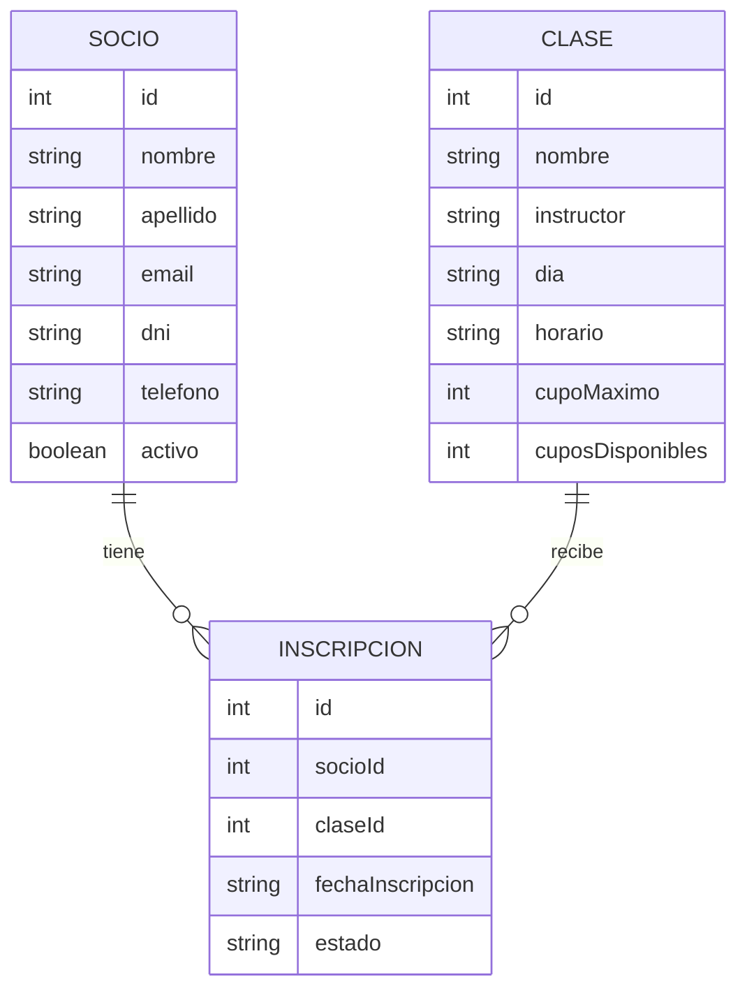

# API Gimnasio

API REST de un gimnasio, hecha como Trabajo Práctico Integrador de Taller de Programación 2 (ORT). Gestiona
**socios**, **clases** e **inscripciones**: un socio se inscribe a clases con cupo limitado.

**Autor:** Leandro Colombo

**Tecnologías:** Node.js (ES Modules), Express 5, Zod, Sequelize + SQLite, JWT (`jsonwebtoken`), `bcryptjs`,
Swagger UI y Vitest.

## Índice
- [Dominio y entidades](#dominio-y-entidades)
- [Relación entre las entidades](#relación-entre-las-entidades)
- [Reglas de negocio](#reglas-de-negocio)
- [Arquitectura](#arquitectura)
- [Instalación y ejecución](#instalación-y-ejecución)
- [Variables de entorno](#variables-de-entorno)
- [Cómo cambiar de persistencia](#cómo-cambiar-de-persistencia)
- [Documentación de la API (Swagger)](#documentación-de-la-api-swagger)
- [Autenticación](#autenticación)
- [Eventos](#eventos)
- [Tests](#tests)
- [Página de demo](#página-de-demo)

## Dominio y entidades

| Entidad | Qué es | Campos principales |
|---|---|---|
| **Socio** | Persona que se inscribe a clases | `id`, `nombre`, `apellido`, `email` (único), `dni` (único), `telefono` (opcional), `activo` |
| **Clase** | Actividad con día, horario y cupo | `id`, `nombre`, `instructor`, `dia`, `horario`, `cupoMaximo`, `cuposDisponibles` (lo calcula el sistema) |
| **Inscripción** | Une a un socio con una clase | `id`, `socioId`, `claseId`, `fechaInscripcion`, `estado` (`activa` o `cancelada`) |
| **Usuario** | Solo para iniciar sesión (no tiene CRUD) | `id`, `email`, `passwordHash`, `rol` |

Socios y Clases tienen CRUD completo (listar, obtener por id, crear, actualizar y eliminar). Las inscripciones
se crean y se **cancelan**; nunca se borran, para conservar el historial.

## Relación entre las entidades

Un socio puede estar inscripto en muchas clases y una clase tiene muchos socios: es una relación **N a N**, que se
resuelve con la tabla intermedia **Inscripción** (dos relaciones 1 a N).



Las consultas de la relación (`GET /socios/:id/clases` y `GET /clases/:id/socios`) solo cuentan las inscripciones
**activas**.

## Reglas de negocio

Todas viven en los casos de uso (`usecases/`), no en las rutas ni en los controladores.

| Regla | Error |
|---|---|
| El email y el DNI de un socio no pueden repetirse (alta y modificación) | 409 `EMAIL_DUPLICADO` / `DNI_DUPLICADO` |
| No se puede borrar un socio ni una clase con inscripciones activas | 409 `SOCIO_CON_INSCRIPCIONES` / `CLASE_CON_INSCRIPCIONES` |
| No se puede bajar el `cupoMaximo` por debajo de los inscriptos activos | 409 `CUPO_INVALIDO` |
| Inscribir: el socio y la clase deben existir | 404 `SOCIO_NOT_FOUND` / `CLASE_NOT_FOUND` |
| Inscribir: el socio debe estar activo | 409 `SOCIO_INACTIVO` |
| Inscribir: no puede estar ya inscripto en esa clase | 409 `YA_INSCRIPTO` |
| Inscribir: la clase debe tener cupo | 409 `CLASE_SIN_CUPO` |
| Cancelar una inscripción que ya estaba cancelada | 409 `INSCRIPCION_YA_CANCELADA` |

Los chequeos de inscribir se hacen en ese orden y el primero que falla corta con su error. Los cupos se
calculan solos: al crear una clase `cuposDisponibles = cupoMaximo`, al inscribir baja 1 y al cancelar sube 1.

## Arquitectura

Arquitectura en capas con inyección de dependencias manual:

```
Request → routes (validación con Zod) → controllers → usecases → dao → memoria o base de datos
                                                          │
                                                          └→ events → alerts (listeners) → notificadores
errores → AppError → errorHandler → { "error": { "code", "message", "details" } }
```

| Carpeta | Responsabilidad |
|---|---|
| `routes/` | Rutas y validación de body, params y query |
| `controllers/` | Traducen HTTP a casos de uso (sin reglas de negocio) |
| `usecases/` | Reglas de negocio; reciben sus dependencias por parámetro |
| `dao/` | Acceso a datos: un DAO en memoria y uno con Sequelize por entidad |
| `container/` | Composition Root: arma DAOs, casos de uso, controladores y routers |
| `schemas/` | Schemas de Zod |
| `middlewares/` | `validate`, `requireAuth`, `logger`, `errorHandler`, `notFound` |
| `errors/` | `AppError` (`code`, `message`, `statusCode`, `details`) |
| `config/` | `config.js`: única lectura de las variables de entorno |
| `events/`, `alerts/`, `notifications/` | Bus de eventos, listeners y notificadores |
| `auth/` | Servicios de JWT y de contraseñas |
| `tests/` | Tests con Vitest |
| `docs/` | `openapi.yaml` y documentación de la API |

`index.js` solo arranca el servidor y monta el router que entrega el contenedor. Hay una guía más detallada de cada
carpeta en su `AGENTS.md`.

## Instalación y ejecución

Requisitos: Node.js 22.12 o superior (lo pide Vitest).

```bash
npm install
cp .env.example .env     # en Windows (PowerShell): Copy-Item .env.example .env
npm run dev              # servidor con recarga automática
```

El servidor queda en http://localhost:8000. Otros comandos:

| Comando | Qué hace |
|---|---|
| `npm run dev` | Servidor con recarga automática (usa `.env`) |
| `npm start` | Servidor normal (usa `.env`) |
| `npm test` | Corre los tests |
| `npm run paridad` | Prueba la API con pedidos fijos (ver [Persistencia](#cómo-cambiar-de-persistencia)) |

Para comprobar que anda: http://localhost:8000/health responde `{ "status": "ok" }`.

## Variables de entorno

Se leen solo en `config/config.js`. El archivo `.env` no se versiona: se crea a partir de `.env.example`.

| Variable | Default | Descripción |
|---|---|---|
| `PORT` | `8000` | Puerto del servidor |
| `NODE_ENV` | `development` | Entorno |
| `PERSISTENCE_TYPE` | `memory` | Dónde se guardan los datos: `memory` o `sequelize` |
| `DB_STORAGE` | `./database.sqlite` | Archivo de SQLite (solo con `sequelize`) |
| `CUPO_BAJO_THRESHOLD` | `2` | Cupos libres a partir de los cuales se emite `clase.cupoBajo` |
| `NOTIFIER_TYPE` | `console` | Notificador de la bienvenida (`console` o `file`) |
| `ALERT_NOTIFIER_TYPE` | `file` | Notificador de las alertas (`console` o `file`) |
| `JWT_SECRET` | `secreto-solo-para-desarrollo` | Secreto con el que se firman los tokens. En producción es obligatorio |
| `JWT_EXPIRES_IN` | `1h` | Duración del token |
| `ADMIN_EMAIL` | `admin@gimnasio.com` | Email del administrador que se crea al arrancar |
| `ADMIN_PASSWORD` | sin valor | Contraseña del administrador. Sin ella no se crea ningún usuario |

Los valores de `.env.example` son solo de ejemplo.

## Cómo cambiar de persistencia

Los datos se pueden guardar de dos maneras, que se eligen con `PERSISTENCE_TYPE` en el `.env`
(**hay que reiniciar el servidor** al cambiarla):

| `PERSISTENCE_TYPE` | Qué usa | Datos |
|---|---|---|
| `memory` | Arrays en memoria | Se pierden al reiniciar el servidor |
| `sequelize` | Sequelize + SQLite, en el archivo de `DB_STORAGE` (por defecto `./database.sqlite`) | Persisten |

Cada entidad tiene un DAO por modo, con la **misma interfaz**. Los casos de uso, los controladores y las rutas no
cambian: solo cambia el DAO que elige `dao/daoFactory.js`. Los DAO devuelven objetos planos, nunca instancias del
ORM, y los dos modos responden igual (misma forma y mismos códigos).

- Con `sequelize`, al arrancar se crean las tablas y, si están vacías, se cargan los mismos datos de ejemplo que en
  memoria. Las asociaciones están centralizadas en `dao/models/index.js`.
- Para volver a los datos de ejemplo, apagar el servidor y borrar `database.sqlite`.
- Inscribir y cancelar usan una **transacción**: la inscripción y el cupo de la clase se actualizan juntos, o no se
  actualiza ninguno.
- Para comprobar que los dos modos responden igual, con el servidor levantado en cada modo y la base vacía:

```bash
npm run paridad -- http://localhost:8000 memory.json          # con PERSISTENCE_TYPE=memory
npm run paridad -- http://localhost:8000 sequelize.json       # con PERSISTENCE_TYPE=sequelize
npm run paridad:comparar -- memory.json sequelize.json        # sin diferencias = OK
```

### Datos de ejemplo

| Entidad | Datos |
|---|---|
| Socios | 1 Lucía Fernández, 2 Martín Gómez, 3 Sofía Ramírez (**inactiva**) |
| Clases | 1 Funcional (lunes 08:00, cupo 10), 2 Spinning (miércoles 19:00, **cupo 2**), 3 Yoga (viernes 18:00, cupo 15) |

Spinning tiene cupo 2 para probar `CLASE_SIN_CUPO` y el evento de cupo bajo; la socia 3 está inactiva para probar
`SOCIO_INACTIVO`.

## Documentación de la API (Swagger)

La API está documentada con OpenAPI 3 (`docs/openapi.yaml`) y publicada con Swagger UI en:

**http://localhost:8000/api-docs**

Ahí están todos los endpoints con sus parámetros, ejemplos y respuestas (éxito y errores), y se pueden probar con
**Try it out** en cualquiera de los dos modos de persistencia. Para los endpoints protegidos, primero hay que
iniciar sesión (ver abajo) y cargar el token con el botón **Authorize**. Además hay casos de prueba manuales en
`requests.http` (extensión REST Client de VS Code).

## Autenticación

Los endpoints que **modifican datos** (`POST`, `PUT`, `PATCH` y `DELETE` de socios, clases e inscripciones) están
protegidos con **JWT**. Los `GET` y el login son públicos.

1. `POST /auth/login` con el email y la contraseña del administrador devuelve un `token`.
2. Ese token se envía en cada pedido protegido: `Authorization: Bearer <token>`. En Swagger UI se carga una vez
   con el botón **Authorize**.
3. Sin token, o con uno inválido o vencido, la API responde `401`.

- El usuario administrador se crea al arrancar con `ADMIN_EMAIL` y `ADMIN_PASSWORD` del `.env`. La contraseña se
  guarda **hasheada** con bcrypt: nunca en texto plano.
- El token vence a las `JWT_EXPIRES_IN` (por defecto `1h`) y se firma con `JWT_SECRET`.
- Con los valores de ejemplo del `.env.example`, el login es `admin@gimnasio.com` / `admin1234`.

## Eventos

La aplicación usa un bus de eventos (`EventEmitter`, en `events/eventBus.js`) que se crea e inyecta desde el
contenedor. Los casos de uso **emiten** un evento cuando algo importante ocurre y los **listeners** (carpeta
`alerts/`) reaccionan, sin que el caso de uso sepa qué hacen. Los eventos se emiten solo si la operación se
concretó: si la inscripción falla no se notifica nada.

| Evento | Se emite cuando | Payload | Qué hace su listener | Notificador |
|---|---|---|---|---|
| `inscripcion.creada` | Se inscribe un socio a una clase | `{ inscripcionId, socio: { id, nombre, email }, clase: { id, nombre, dia, horario } }` | `alerts/registerInscripcionListeners.js`: envía la bienvenida al socio | Principal (`NOTIFIER_TYPE`, consola por defecto) |
| `clase.cupoBajo` | Tras inscribir, la clase queda con `cuposDisponibles <= CUPO_BAJO_THRESHOLD` | `{ claseId, nombre, cuposDisponibles }` | `alerts/registerCupoListeners.js`: avisa al staff | De alertas (`ALERT_NOTIFIER_TYPE`, archivo `alerts.log` por defecto) |

Los nombres de los eventos están en `events/eventNames.js` y el armado (bus, notificadores y listeners) se hace en
`container/container.js`.

### Notificadores

Todos implementan la misma interfaz `notify({ subject, body })`, por eso se pueden intercambiar sin tocar los
casos de uso ni los listeners:

- `console`: escribe en la consola.
- `file`: agrega al final de un archivo (`notifications.log` para la bienvenida, `alerts.log` para las alertas).
  Los `.log` no se versionan.

Cada listener captura sus propios errores (`try/catch` + `console.error`): si un notificador falla, la
inscripción ya realizada igual responde `201`.

## Tests

Los casos de uso y el dominio tienen tests automáticos con **Vitest**, que no necesitan servidor ni base de datos:
usan los DAO en memoria como dobles.

```bash
npm test
```

Se desarrollaron con **Spec Driven Development**: primero se escribió la especificación
(`docs/specs/casos-de-uso.spec.md`, donde cada comportamiento tiene un id como `INS-05`) y cada test lleva ese id en
su nombre. Cubren el camino feliz, cada error (con su `code` y su `statusCode`), los eventos y los casos margen
(último cupo, lista vacía, página fuera de rango...). Guía: `tests/AGENTS.md`.

## Página de demo

Con el servidor levantado, la página http://localhost:8000 permite probar la API desde el navegador: iniciar
sesión, ver clases y socios, crear, modificar y borrar clases, crear, activar/desactivar y borrar socios, inscribir y cancelar. Cuando la API responde con un error
(por ejemplo `CLASE_SIN_CUPO` o `401`) lo muestra arriba con su código.

Es una sola página (`public/index.html`) con HTML y JavaScript puro que llama a la API con `fetch`. No forma parte
de la API: es una ayuda para la demo.
